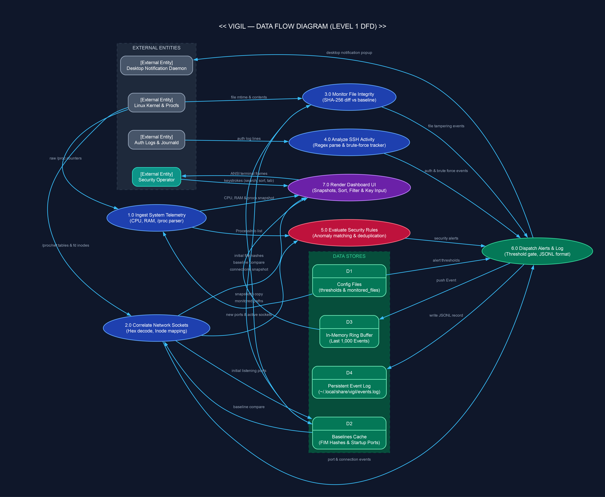
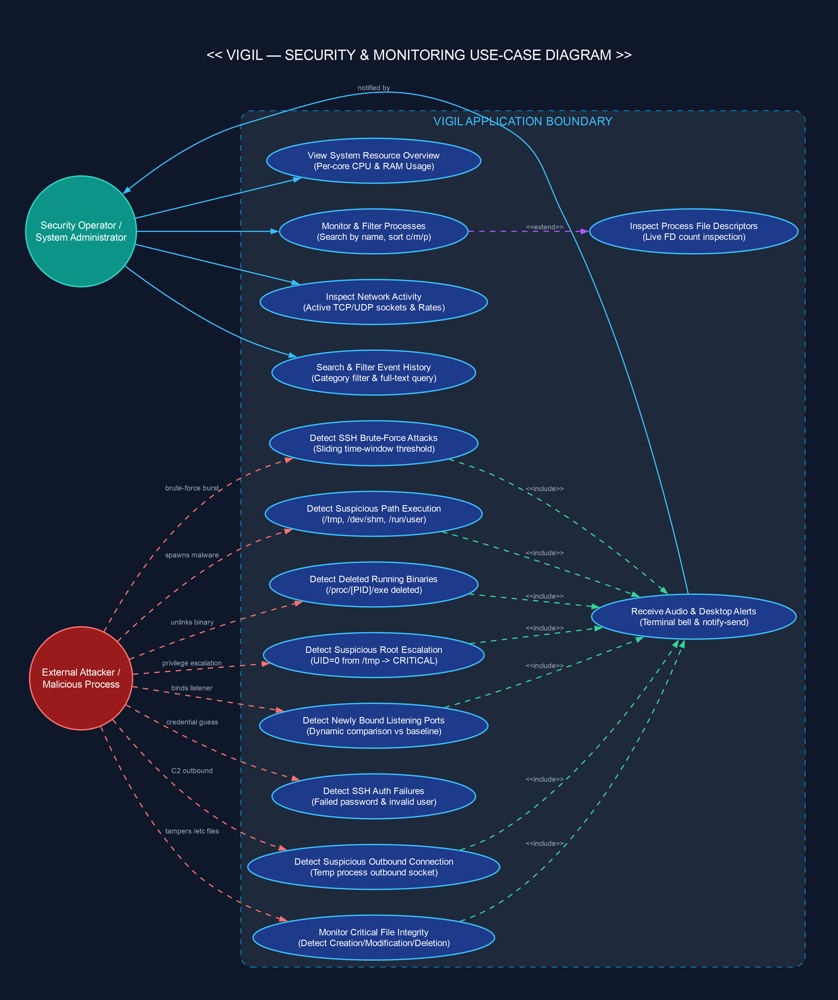
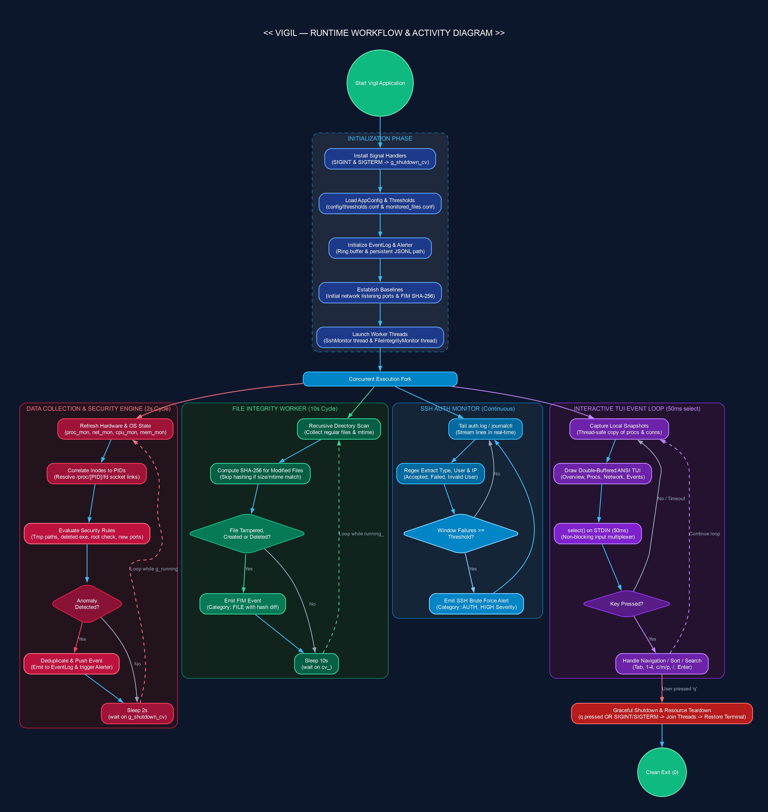

# Vigil — Architecture and Design Diagrams

> **Academic & Technical Report Reference Documentation**  
> *This document provides formal architecture, data flow, use-case, and workflow diagrams for Vigil, ready to be embedded directly into project reports, design specifications, and technical reviews.*

---

## Table of Contents
1. [Overall System Architecture Diagram](#1-overall-system-architecture-diagram)
2. [Data Flow Diagram (DFD)](#2-data-flow-diagram-dfd)
3. [Use-Case Diagram](#3-use-case-diagram)
4. [Workflow / Activity Diagram](#4-workflow--activity-diagram)
5. [Subsystem & Component Details](#5-subsystem--component-details)

---

## 1. Overall System Architecture Diagram

The **Overall System Architecture Diagram** presents the multi-tier component model of Vigil. It illustrates how low-level Linux kernel interfaces and operating system files are ingested by modular C++ collectors, analyzed by an independent security rules engine, dispatched through an in-memory ring buffer to persistent storage and alert handlers, and rendered on an interactive ANSI TUI dashboard.

### Architectural Diagram


*High-resolution vector version: [1_system_architecture.svg](diagrams/1_system_architecture.svg)*

```mermaid
graph TB
    subgraph OS["HOST OPERATING SYSTEM & KERNEL SUBSYSTEMS"]
        proc_stat["/proc/stat (CPU ticks & per-core)"]
        proc_mem["/proc/meminfo (RAM & swap)"]
        proc_pid["/proc/[PID]/* (stat, exe readlink, fd/*)"]
        proc_net["/proc/net/tcp, udp, dev (Sockets & Rates)"]
        auth_logs["/var/log/auth.log & journald (SSH auth)"]
        fs_paths["Monitored Paths (/etc/passwd, /etc/shadow)"]
    end

    subgraph INGEST["INGESTION & DATA COLLECTION (lsm_lib)"]
        cpu_mon["cpu::CpuMonitor"]
        mem_mon["mem::MemoryMonitor"]
        proc_mon["proc::ProcessMonitor"]
        net_mon["net::NetworkMonitor (Hex decoders & Inodes)"]
        ssh_mon["ssh::SshMonitor (Worker Thread)"]
        fim_mon["integrity::FileIntegrityMonitor (Worker Thread)"]
    end

    proc_stat --> cpu_mon
    proc_mem --> mem_mon
    proc_pid --> proc_mon
    proc_net --> net_mon
    proc_pid -.->|inode correlation| net_mon
    auth_logs --> ssh_mon
    fs_paths --> fim_mon

    subgraph ENGINE["DETECTION & SECURITY RULES ENGINE"]
        sec_engine["rules::SecurityEngine"]
        rule_tmp["check_tmp_process (/tmp, /dev/shm)"]
        rule_del["check_deleted_exe (Unlinked running binary)"]
        rule_root["check_root_suspicious (UID=0 in /tmp -> CRITICAL)"]
        rule_port["check_new_listening_port (Dynamic port diff)"]
        rule_out["check_suspicious_outbound (Temp outbound socket)"]
        dedup["Alert Deduplicator Cache"]
        sec_engine --- rule_tmp
        sec_engine --- rule_del
        sec_engine --- rule_root
        sec_engine --- rule_port
        sec_engine --- rule_out
        sec_engine --- dedup
    end

    proc_mon -->|ProcessInfo list| sec_engine
    net_mon -->|new_ports & active sockets| sec_engine

    subgraph EVENTS["EVENT SYSTEM & ALERTING"]
        event_log["events::EventLog (Ring Buffer, 1000 items)"]
        disk_log[("Persistent Storage (~/.../events.log JSONL)")]
        alerter["alert::Alerter (Threshold Gated)"]
        bell["Terminal Bell (\\a)"]
        notify["Desktop notify-send Popup"]

        event_log --> disk_log
        event_log --> alerter
        alerter --> bell
        alerter --> notify
    end

    sec_engine -->|Security Events| event_log
    ssh_mon -->|Auth / Brute Force| event_log
    fim_mon -->|File Tamper Events| event_log
    net_mon -->|Port / Closed Conn| event_log

    subgraph UI["PRESENTATION LAYER (ui::Terminal)"]
        ui_loop["ui::Terminal & Event Loop (select() 50ms)"]
        p_overview["Overview Panel (CPU bars, RAM)"]
        p_procs["Processes Panel (Sort, Search, Anomaly Color)"]
        p_net["Network Panel (Sockets, Rates, Ports)"]
        p_events["Events Panel (Category Filter, Query)"]

        ui_loop --> p_overview
        ui_loop --> p_procs
        ui_loop --> p_net
        ui_loop --> p_events
    end

    cpu_mon --> ui_loop
    mem_mon --> ui_loop
    proc_mon -->|Thread-safe snapshot| ui_loop
    net_mon -->|Thread-safe snapshot| ui_loop
    event_log -->|snapshot() copy| ui_loop

    admin(("Security Operator")) <-->|ANSI Raw TUI / Keystrokes| ui_loop
```

### Architectural Description

1. **Kernel & Telemetry Interfaces**: Vigil communicates directly with Linux pseudofilesystems (`/proc/stat`, `/proc/meminfo`, `/proc/[PID]/`, `/proc/net/`) to gather zero-overhead host telemetry without kernel modules or invasive eBPF dependencies.
2. **Dedicated Background Workers**:
   - `ssh::SshMonitor`: Runs on a dedicated background thread to stream authentication log lines via `tail` or `journalctl`.
   - `integrity::FileIntegrityMonitor`: Runs on an asynchronous 10-second polling cycle to compute RFC-6234 SHA-256 hashes across monitored filesystem branches.
3. **Pure Function Security Engine**: `rules::SecurityEngine` evaluates decoupled rule functions (`check_tmp_process`, `check_deleted_exe`, `check_root_suspicious`, etc.) against immutable telemetry snapshots and deduplicates alert instances via a hash cache `std::set<std::pair<int, std::string>>`.
4. **Decoupled Event Dispatch & Storage**: An in-memory ring buffer (bounded to 1,000 items) stores recent security events for fast UI retrieval and full-text keyword querying. Events are simultaneously serialized as structured JSON Lines into `~/.local/share/vigil/events.log`.
5. **Interactive UI & Input Multiplexer**: An ANSI 24-bit TrueColor rendering loop uses POSIX `select()` with a 50ms polling timeout on `STDIN_FILENO`, ensuring instant responsiveness to keyboard input without stalling data collection threads.

---

## 2. Data Flow Diagram (DFD)

The **Level 1 Data Flow Diagram** traces the transformation of raw operational data from system entry points into normalized models, evaluates them against security heuristics, stores them, and produces alert dispatches and user interface visualizations.

### Data Flow Diagram



*High-resolution vector version: [2_data_flow_diagram.svg](diagrams/2_data_flow_diagram.svg)*

```mermaid
flowchart LR
    subgraph ENTITIES["External Entities"]
        E1["Linux Kernel & Procfs"]
        E2["Auth Logs / Systemd"]
        E3["Security Operator"]
        E4["Desktop Notification Daemon"]
    end

    subgraph PROCESSES["Vigil Processing Functions"]
        P1["1.0 Ingest & Normalize Telemetry"]
        P2["2.0 Correlate Sockets & Inodes"]
        P3["3.0 Monitor File Integrity"]
        P4["4.0 Analyze SSH Authentication"]
        P5["5.0 Evaluate Security Rules"]
        P6["6.0 Dispatch Alerts & Persist"]
        P7["7.0 Render Dashboard TUI"]
    end

    subgraph STORES["Data Stores"]
        D1[("D1: Config Store\nthresholds & monitored_files")]
        D2[("D2: Baselines Cache\nPorts & SHA-256 Map")]
        D3[("D3: Event Ring Buffer\nIn-Memory 1000 Events")]
        D4[("D4: Persistent JSONL Log\nevents.log")]
    end

    D1 -->|Monitored paths| P1
    D1 -->|Threshold levels| P6

    E1 -->|/proc CPU & Mem| P1
    E1 -->|/proc/net & /proc/PID/fd| P2
    E1 -->|File contents & mtime| P3
    E2 -->|Syslog lines| P4

    P3 <-->|Store & compare hashes| D2
    P2 <-->|Store & compare listening ports| D2

    P1 -->|ProcessInfo snapshots| P5
    P2 -->|Active & new sockets| P5

    P5 -->|Security alerts| P6
    P3 -->|FIM changes| P6
    P4 -->|Auth failures & brute force| P6
    P2 -->|Port deltas & closed conns| P6

    P6 -->|Push event| D3
    P6 -->|Write JSON line| D4
    P6 -->|notify-send| E4

    D3 -->|snapshot() copy| P7
    P1 -->|Process & HW snapshots| P7
    P2 -->|Socket snapshot| P7

    E3 <-->|Keystrokes / ANSI frames| P7
```

### Data Flow Steps
- **Data Ingestion**: Processes `P1.0` through `P4.0` ingest raw OS metrics, normalize hex values to dotted-decimal IPv4/IPv6 addresses, resolve `/proc/[PID]/fd/` socket inodes to process PIDs, and extract SSH usernames and timestamps.
- **State Baseline Comparison**: Processes `P2.0` and `P3.0` consult `D2: Baselines Cache` to detect differences between startup state and runtime mutations (new listening ports or altered SHA-256 hashes).
- **Rule Processing & Deduplication**: Process `P5.0` applies heuristics across process paths, user privileges (`UID=0`), binary unlinking flags, and network socket directions.
- **Persistence & Alerts**: Process `P6.0` routes events into memory `D3`, writes escaped JSONL strings to `D4`, rings the terminal bell (`\a`), and triggers asynchronous desktop notification popups via `E4`.
- **Presentation**: Process `P7.0` generates formatted terminal screens based on operator keystrokes (`E3`).

---

## 3. Use-Case Diagram

The **Use-Case Diagram** describes the operational scenarios supported by Vigil, illustrating how the **Security Operator** monitors system state and how **Threat Actors** trigger automated detection mechanisms.

### Use-Case Diagram



*High-resolution vector version: [3_use_case_diagram.svg](diagrams/3_use_case_diagram.svg)*

```mermaid
flowchart LR
    subgraph ACTORS["Actors"]
        Admin(("Security Operator /\\nSystem Administrator"))
        Attacker(("External Attacker /\\nMalicious Process"))
    end

    subgraph SYSTEM["Vigil Security Monitoring System"]
        UC1(["UC1: View System Resources Overview (CPU/RAM)"])
        UC2(["UC2: Inspect & Filter Running Processes"])
        UC2_1(["UC2.1: Inspect Process Open File Descriptors"]):::extend
        UC3(["UC3: Monitor Network Activity & Sockets"])
        UC4(["UC4: Detect Process Execution Anomalies"])
        UC5(["UC5: Monitor Critical File System Integrity"])
        UC6(["UC6: Detect SSH Authentication Attacks"])
        UC7(["UC7: Search & Filter Security Event History"])
        UC8(["UC8: Receive Audio & Desktop Notifications"]):::include
    end

    Admin --> UC1
    Admin --> UC2
    Admin --> UC3
    Admin --> UC7
    UC8 -.->|notified by| Admin

    UC2 -.->|<<extend>>| UC2_1

    Attacker -.->|spawns /tmp or deleted binary| UC4
    Attacker -.->|tampers /etc/passwd or /etc/shadow| UC5
    Attacker -.->|initiates brute force credential guessing| UC6
    Attacker -.->|opens unauthorized backdoor listener| UC3

    UC4 -.->|<<include>>| UC8
    UC5 -.->|<<include>>| UC8
    UC6 -.->|<<include>>| UC8
    UC3 -.->|<<include>>| UC8

    classDef extend fill:#3B0764,stroke:#C084FC,stroke-dasharray: 5 5;
    classDef include fill:#064E3B,stroke:#34D399,stroke-dasharray: 5 5;
```



### Key Use-Cases

- **UC1: View System Resources Overview**: The operator tracks live total and per-core CPU utilization bars and RAM/swap consumption to detect cryptominers or denial-of-service spikes.
- **UC2: Inspect & Filter Running Processes**: Real-time process listing with instantaneous sorting (`c` for CPU, `m` for memory, `p` for PID) and live regex/substring searching (`/`).
- **UC2.1: Inspect Process Open File Descriptors**: Pressing `Enter` on any process opens an in-depth inspector displaying open file descriptor counts and full executable paths.
- **UC3: Monitor Network Activity & Sockets**: Enumerates network interfaces with RX/TX rates and displays active TCP/UDP connections mapped to process names and PIDs.
- **UC4: Detect Process Execution Anomalies**: Identifies evasive processes executing out of `/tmp`, `/dev/shm`, `/run/user`, processes running with unlinked binaries (`(deleted)`), or root processes from suspicious locations.
- **UC5: Monitor Critical File System Integrity**: Automatically alerts when monitored system files (`/etc/passwd`, `/etc/shadow`, `/etc/sudoers`) or configured directories undergo modification, creation, or deletion.
- **UC6: Detect SSH Authentication Attacks**: Continuously parses authentication streams to identify invalid users, failed logins, and brute-force bursts exceeding threshold limits in a sliding time window.
- **UC7: Search & Filter Security Event History**: Operators can cycle through category filters (Auth, Process, Network, File, System) or execute instant substring searches across recorded events.
- **UC8: Receive Audio & Desktop Notifications**: Severity-gated terminal bell alerts and non-blocking desktop popups notify operators even when the Vigil dashboard is minimized.

---

## 4. Workflow / Activity Diagram

The **Workflow / Activity Diagram** illustrates the end-to-end operational lifecycle of Vigil from startup initialization to multi-threaded concurrent monitoring, polling loops, anomaly evaluation, and synchronized teardown.

### Workflow Diagram



*High-resolution vector version: [4_workflow_activity_diagram.svg](diagrams/4_workflow_activity_diagram.svg)*

```mermaid
stateDiagram-v2
    [*] --> StartupInit

    state StartupInit {
        direction TB
        InstallSignalHandlers: Install SIGINT & SIGTERM Handlers
        LoadConfig: Load config/thresholds.conf & monitored_files.conf
        InitEventLog: Initialize EventLog & Register Alerter
        CaptureBaselines: Baseline Listening Ports & Compute Initial SHA-256
        SpawnThreads: Spawn SshMonitor & FileIntegrityMonitor Threads

        InstallSignalHandlers --> LoadConfig
        LoadConfig --> InitEventLog
        InitEventLog --> CaptureBaselines
        CaptureBaselines --> SpawnThreads
    }

    StartupInit --> ConcurrentExecution

    state ConcurrentExecution {
        direction TB

        state "Data Collection & Rules Thread (Every 2s)" as DataThread {
            RefreshProcNet: Refresh /proc/stat, /proc/meminfo, /proc/*/status, /proc/net/*
            ResolveInodes: Map Socket Inodes to Process PIDs
            EvalRules: Run Security Rules (Tmp path, Deleted exe, Root check)
            CheckAnomaly: Anomaly Detected?
            DedupPush: Deduplicate & Push Event to Ring Buffer
            Wait2s: Wait 2s on g_shutdown_cv

            RefreshProcNet --> ResolveInodes
            ResolveInodes --> EvalRules
            EvalRules --> CheckAnomaly
            CheckAnomaly --> DedupPush: Yes
            CheckAnomaly --> Wait2s: No
            DedupPush --> Wait2s
            Wait2s --> RefreshProcNet: Loop
        }

        state "File Integrity Thread (Every 10s)" as FimThread {
            RecursiveScan: Recursive Directory Scan & Stat
            HashCheck: Compare Size & Mtime (Rehash if Changed)
            TamperDetected: Mutation Detected?
            EmitFimEvent: Emit Category::FILE Event
            Wait10s: Wait 10s on cv_

            RecursiveScan --> HashCheck
            HashCheck --> TamperDetected
            TamperDetected --> EmitFimEvent: Yes
            TamperDetected --> Wait10s: No
            EmitFimEvent --> Wait10s
            Wait10s --> RecursiveScan: Loop
        }

        state "SSH Monitor Thread (Real-Time)" as SshThread {
            TailLog: Tail /var/log/auth.log or journalctl
            RegexParse: Regex Extract Action, User & IP
            CheckBrute: Window Failures >= Threshold?
            EmitSshAlert: Emit SSH Brute Force Alert (HIGH)

            TailLog --> RegexParse
            RegexParse --> CheckBrute
            CheckBrute --> EmitSshAlert: Yes
            CheckBrute --> TailLog: No
            EmitSshAlert --> TailLog: Loop
        }

        state "Interactive UI Event Loop (50ms select)" as UiThread {
            SnapshotState: Thread-Safe Snapshot of Procs & Conns
            RenderTUI: Render Double-Buffered ANSI Dashboard
            PollStdin: POSIX select() on STDIN (50ms)
            HandleKey: Handle Navigation / Sort / Search Filter

            SnapshotState --> RenderTUI
            RenderTUI --> PollStdin
            PollStdin --> HandleKey: Key Pressed
            PollStdin --> SnapshotState: Timeout (50ms)
            HandleKey --> SnapshotState: Loop
        }
    }

    ConcurrentExecution --> SynchronizedTeardown: User pressed 'q' OR SIGINT/SIGTERM

    state SynchronizedTeardown {
        direction TB
        SetStopFlag: Set g_running = false
        NotifyCVs: Notify g_shutdown_cv & Worker CVs
        JoinWorkers: Stop & Join ssh_mon and file_mon
        JoinDataThread: Join Data Collection Thread
        RestoreTerminal: Restore Terminal Termios & Show Cursor

        SetStopFlag --> NotifyCVs
        NotifyCVs --> JoinWorkers
        JoinWorkers --> JoinDataThread
        JoinDataThread --> RestoreTerminal
    }

    SynchronizedTeardown --> [*]
```

### Detailed Workflow Walkthrough

1. **Initialization Phase**:
   - Signal handlers for `SIGINT` and `SIGTERM` are installed to set an atomic flag `g_running = false` and broadcast across `g_shutdown_cv`.
   - `config::AppConfig::load()` parses thresholds, alert severities, and watched file paths.
   - Initial baselines for open listening ports and SHA-256 hashes of monitored files are collected.
   - Dedicated worker threads for SSH monitoring and File Integrity Monitoring are started.

2. **Concurrent Execution**:
   - **Data Collection Thread**: Wakes up every 2 seconds, takes fresh snapshots of CPU, memory, processes, and network tables, matches socket inodes to running PIDs, and runs the pure-function security engine.
   - **File Integrity Monitor**: Scans monitored directories every 10 seconds. Employs size and modification-time caching to avoid unnecessary hashing of unchanged files.
   - **SSH Monitor**: Continuously tails authentication streams, parses login events, and tracks failed attempts per IP address in a sliding time window.
   - **Interactive UI Event Loop**: Uses non-blocking POSIX `select()` multiplexing on `STDIN_FILENO` with a 50ms polling slice. Keypresses (`Tab`, `1`-`4`, `c`, `m`, `p`, `/`, `Enter`) are processed immediately without blocking monitoring threads.

3. **Synchronized Teardown**:
   - When the user presses `q` or a termination signal is received, `g_running` is set to `false` and condition variables wake up all worker threads.
   - Worker threads terminate and join cleanly.
   - `ui::Terminal` destructor restores the original terminal `termios` attributes, exits the alternate screen buffer, and restores the cursor.

---

## 5. Subsystem & Component Details

| Module | Source Files | Key Responsibilities |
|---|---|---|
| **CPU Monitor** | `cpu.hpp`, `cpu.cpp` | Parses `/proc/stat`; computes overall and per-core utilization percentages using delta calculation across ticks. |
| **Memory Monitor** | `memory.hpp`, `memory.cpp` | Parses `/proc/meminfo`; calculates active, buffered, cached memory and swap usage. |
| **Process Monitor** | `process.hpp`, `process.cpp` | Enumerates `/proc/[PID]/stat`, `status`, `cmdline`, `exe`; maintains PID cache, FD counts, and sorting logic. |
| **Network Monitor** | `network.hpp`, `network.cpp` | Decodes `/proc/net/tcp*`, `udp*`; resolves socket inodes from `/proc/[PID]/fd/*`; identifies newly bound ports. |
| **SSH Monitor** | `ssh_monitor.hpp`, `ssh_monitor.cpp` | Real-time syslog/journald tailing; regex pattern matching for auth attempts; sliding window brute-force detection. |
| **File Integrity** | `file_integrity.hpp`, `file_integrity.cpp` | Standalone SHA-256 calculation; recursive directory baseline hashing; detects file creation, modification, deletion. |
| **Security Rules** | `security_rules.hpp`, `security_rules.cpp` | Pure rule evaluation engine; detects `/tmp` executions, unlinked binaries, root privilege escalation; deduplicates alerts. |
| **Event System** | `event_system.hpp`, `event_system.cpp` | Thread-safe in-memory ring buffer (1,000 items); JSON Lines disk writer; category and keyword querying. |
| **Alert Dispatcher** | `alert.hpp`, `alert.cpp` | Severity-gated terminal bell (`\a`); non-blocking desktop notifications via double-fork `notify-send`. |
| **Configuration** | `config.hpp`, `config.cpp` | INI-style parser for `thresholds.conf` and `monitored_files.conf`; handles comments, whitespace, and aliases. |
| **Terminal UI** | `ui.hpp`, `ui.cpp` | 24-bit TrueColor ANSI rendering; double-buffered screen drawing; non-blocking POSIX `select()` input event loop. |

---

## Generating Diagram Assets

To regenerate the vector SVG and high-resolution PNG image assets at any time:

```bash
python3 scripts/generate_diagrams.py
```

All diagram files are automatically saved to `docs/diagrams/`.
